<h1 align="center">Horizon Aurora</h1>

<p align="center">
  <b>Minecraft: Java Edition 26.3, rewritten in Rust, on Android</b><br>
  An independent fork of <a href="https://github.com/horizon-rust/horizon">Horizon</a> that carries on the Horizon Android port,
  with a redesigned launcher, instances, swappable engines, Horizon Boost and a full touch layout editor.
</p>

<p align="center"><b>English</b> · <a href="README.ru.md">Русский</a></p>

<p align="center">
  
  
  
  
  <a href="LICENSE"></a>
</p>

<p align="center">
  <a href="#download"><b>Download</b></a> ·
  <a href="#whats-new"><b>What's new</b></a> ·
  <a href="#screenshots"><b>Screenshots</b></a> ·
  <a href="#engines-and-instances"><b>Engines &amp; instances</b></a> ·
  <a href="#build"><b>Build</b></a> ·
  <a href="#where-aurora-comes-from"><b>Where it comes from</b></a> ·
  <a href="#credits-and-licence"><b>Credits</b></a>
</p>

<p align="center">
  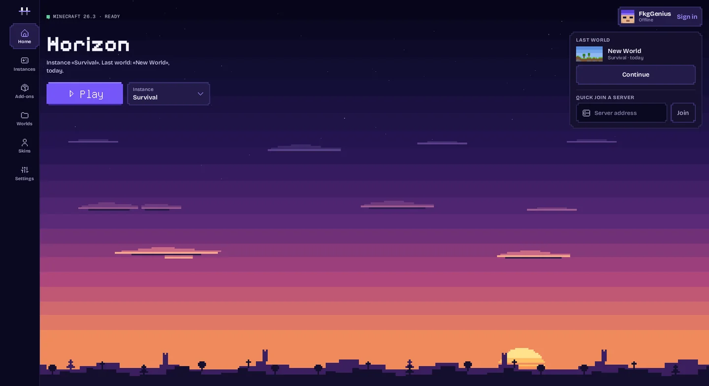
</p>

> **Unofficial and independent.** Horizon Aurora is a fork of [Horizon](https://github.com/horizon-rust/horizon) built on
> the code of Horizon Android, the Android port that has since merged into [Starling](https://github.com/starling-client/starling).
> It is not an official build of Horizon, Horizon Android or Starling, and it is not affiliated with or endorsed by Mojang
> or Microsoft. Report problems with Aurora [here](https://github.com/IAmFuckingGenius/horizon-aurora/issues), not upstream.

## Download

**[Latest release](https://github.com/IAmFuckingGenius/horizon-aurora/releases/latest)**: one APK per architecture;
most phones need **arm64-v8a**. On first start the app downloads Minecraft's original resources from Mojang.
Aurora installs as its own app beside Horizon Android and Starling: **Settings › Account › Move from Horizon Android**
copies its worlds, packs, mods and settings into a new instance (in dev builds now; in 0.7.7-aurora.1, move worlds with
world export and import).
Experimental builds of every change are in the [`dev` pre-release](https://github.com/IAmFuckingGenius/horizon-aurora/releases/tag/dev)
("Aurora Dev", installs beside the release). How releases are made: [docs/android-releases.md](docs/android-releases.md).

## What's new

<table>
  <tr>
    <td width="50%" valign="top">
      <h3>A new launcher</h3>
      Home, Instances, Add-ons, Worlds, Skins and Settings in one pixel-art style, in landscape and portrait.
      Every description is written out in full. English and Russian, with a language switch in Settings.
    </td>
    <td width="50%" valign="top">
      <h3>Instances</h3>
      Each instance has a name, its own worlds, settings and add-ons, and the engine it runs on.
      A new instance starts with your language, controls and graphics settings.
    </td>
  </tr>
  <tr>
    <td valign="top">
      <h3>Swappable engines</h3>
      Build the game on a computer, with native mods compiled in, pack it as a <code>.hengine</code>
      and run it without reinstalling the app. A small boot library loads it for one launch; an engine
      that fails to start falls back to the built-in one and says why.
    </td>
    <td valign="top">
      <h3>Horizon Boost</h3>
      Speed, quality and heat on one Minecraft-style page, each setting with its cost and what it does:
      rain density and splashes, texture animations, sky details, fog, chunk uploads, and a heat limit
      that is Off, Soft, Balanced or Strong, with a frame-rate floor.
    </td>
  </tr>
  <tr>
    <td valign="top">
      <h3>Touch layout editor</h3>
      Drag, pinch and snap every control. Custom buttons with labels, key combinations, toggle and swipe,
      shapes and colours; show each control in game, in menus, always or never; named layouts with undo,
      redo and share codes.
    </td>
    <td valign="top">
      <h3>Accounts and skins</h3>
      Offline, Microsoft and Ely.by accounts with quick switching, and a wardrobe with a 3D preview for
      skins and capes, local or from the account.
    </td>
  </tr>
  <tr>
    <td valign="top">
      <h3>Files through Android</h3>
      Import and export worlds as ZIPs, share reports and logs, all through Android's system file picker:
      no storage permission needed.
    </td>
    <td valign="top">
      <h3>Phone-friendly engine</h3>
      Saves single player when you leave the app, eases off under heat, frees caches under memory pressure,
      and draws rain with a cheaper shader.
    </td>
  </tr>
</table>

## Screenshots

Waydroid (x86_64), landscape. The in-game pages use Minecraft's own widgets.

| Instances | An instance and its engine |
| --- | --- |
| 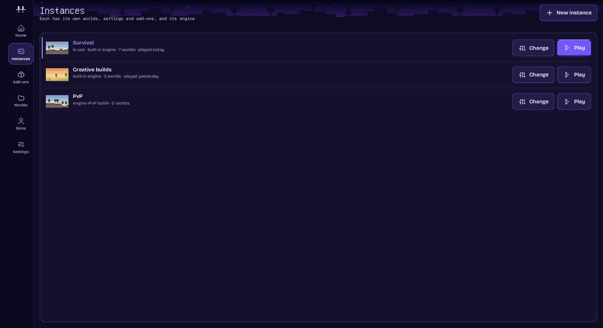 | 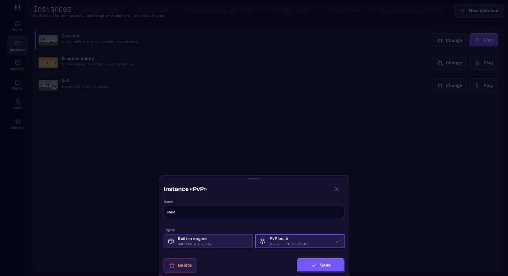 |

| Engines | Skins and capes |
| --- | --- |
| 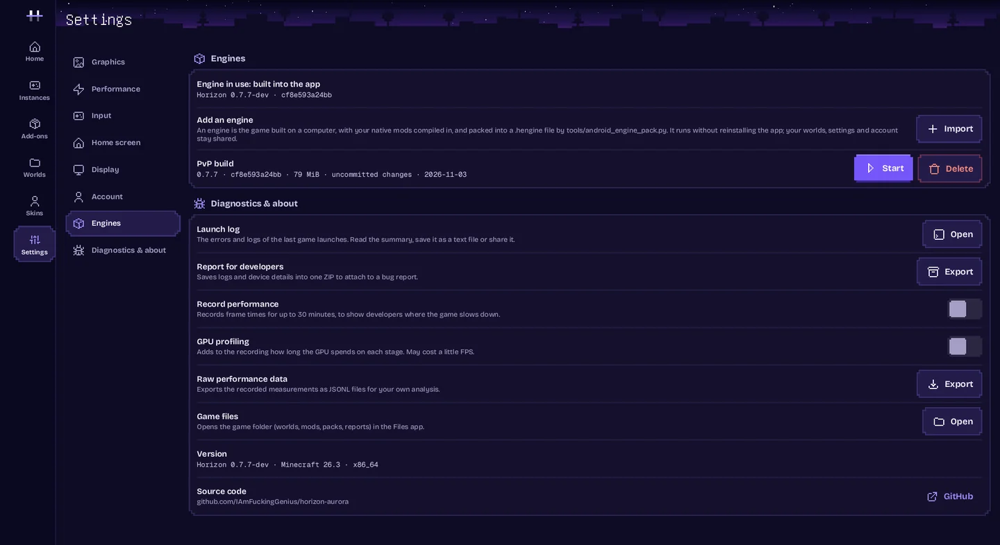 | 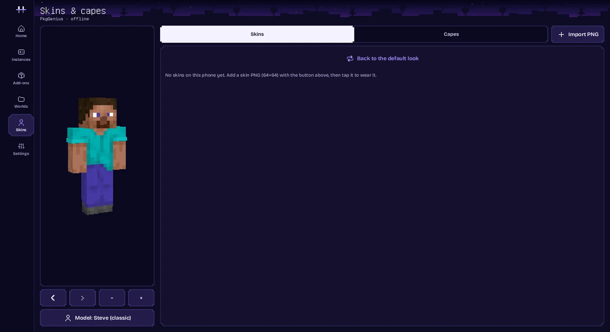 |

| Accounts | Worlds |
| --- | --- |
| 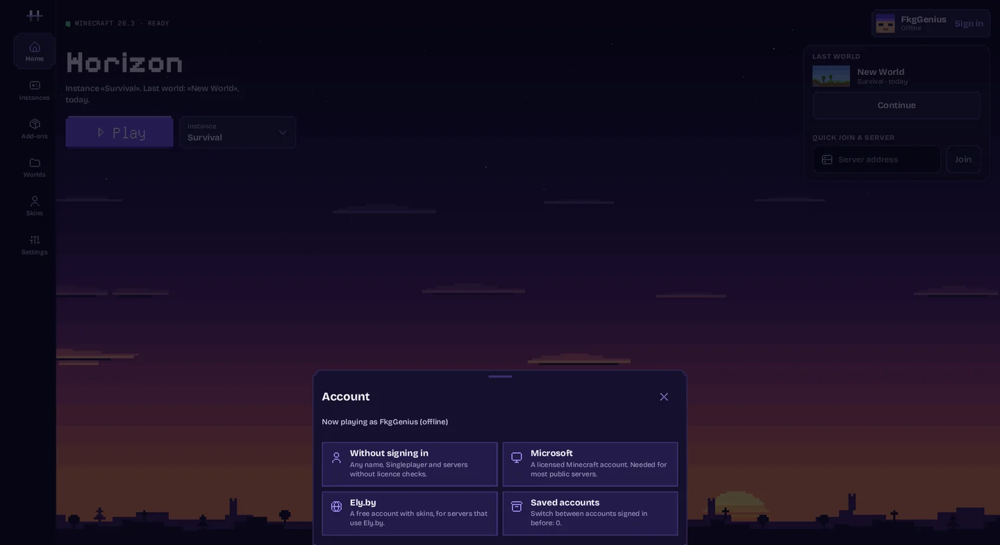 | 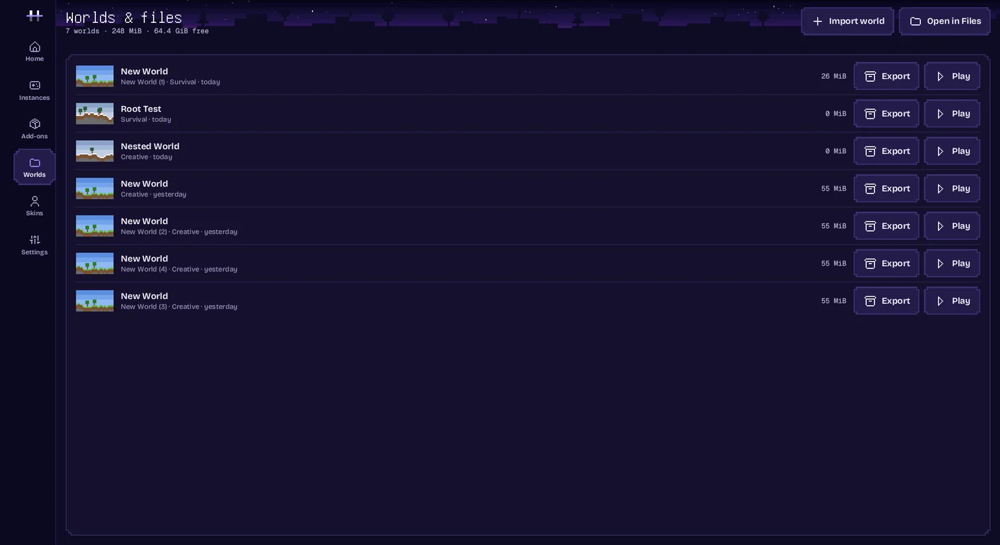 |

| Horizon Boost | Heat limit |
| --- | --- |
| 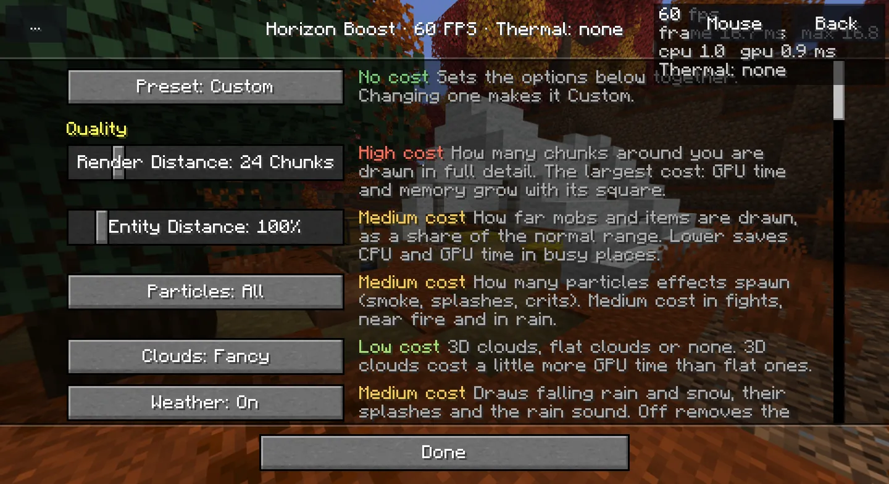 | 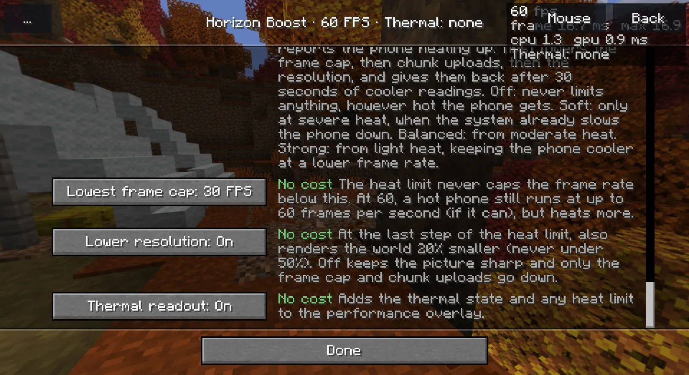 |

| In a world | Touch layout editor |
| --- | --- |
| 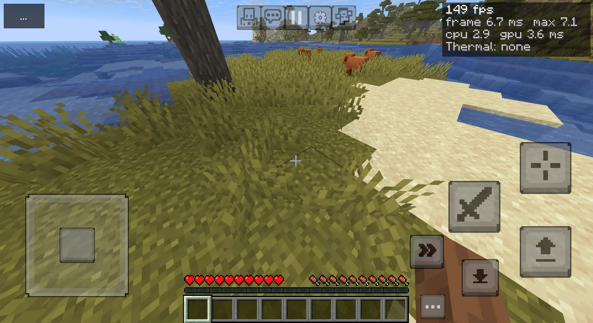 | 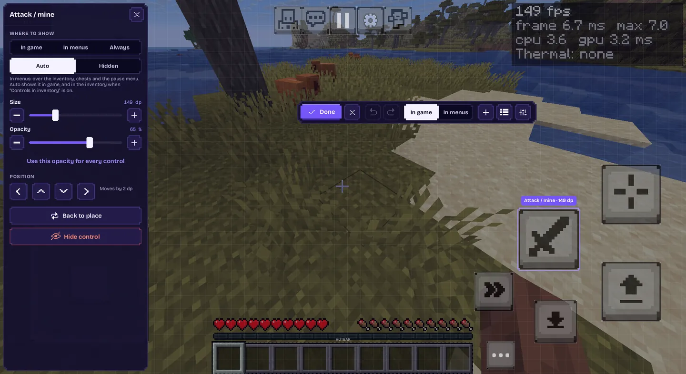 |

## Engines and instances

An **engine** is the game itself: the same `libhorizon_android.so` the APK carries, built from any tree, for example
with native mods compiled in. An **instance** is what you play: a name, an engine and a game folder.

```sh
# On a computer, from this repository: build and pack an engine for your phone
python3 tools/android_engine_pack.py --abi arm64-v8a --name "My modpack"
# → .local/android/engines/<id>-arm64-v8a.hengine
```

Copy the file to the phone, then in the launcher: **Settings › Engines › Import** (the launcher asks first: an engine
runs with all the app's rights, so install only engines you built or trust). Create an instance on it under
**Instances › New instance**, and press **Play**: the app restarts on that engine and opens the instance. Worlds,
accounts and downloaded game files stay shared.

Or skip the computer: **Settings › Engines › Engines from Aurora** downloads the newest dev engine, or a newer
release's engine, straight from this repository's releases, checked against the release's list.

How it works, the `.hengine` format and the checks on import: [docs/android-engines.md](docs/android-engines.md).

## Build

Building needs the Android SDK and NDK; setup and the resource preparation are in [docs/android.md](docs/android.md).

```sh
python3 tools/android_build.py --abi arm64-v8a            # a debug APK for your own phone
python3 tools/android_build.py --abi arm64-v8a --public   # a distribution APK
```

Only public APKs may be shared: they contain Horizon's generated tables and download the original Minecraft resources
from Mojang on the device. Development APKs may carry private resource bundles. More in
[docs/android-publication.md](docs/android-publication.md). Tests for the fork's Android parts:

```sh
python3 tools/test_android_engines.py   # engines, the boot library and instances
python3 tools/test_android_worlds.py    # world ZIP import and export
```

## Languages

The launcher and every setting added by this fork are written in English and translated into Russian. The launcher
follows Android's language or the choice under **Settings › Display › Language**; the game has its own language in
its Options, with Minecraft's translations for vanilla text.

## Where Aurora comes from

- **[Horizon](https://github.com/horizon-rust/horizon)** is Minecraft: Java Edition 26.3 rewritten in Rust, checked
  against the real game by differential harnesses. Aurora is a fork of it and merges its changes directly.
- **Horizon Android** ported Horizon to Android: the native activity, Vulkan and GLES rendering, touch controls, the
  launcher, on-device resource installation. In November 2026 it merged into
  [Starling](https://github.com/starling-client/starling), a separate Android port that became the base of the merged
  project; Horizon Android 0.7.8 was its last release.
- **Horizon Aurora** keeps Horizon Android's code as its base and goes on with it on its own: its own launcher, instances,
  engines, Horizon Boost and releases, Horizon's updates merged here, and Horizon Android's last fixes carried over.

## Credits and licence

- [Horizon](https://github.com/horizon-rust/horizon) by Ludovic Marie and the Horizon contributors: the Rust engine.
- Horizon Android by Vasysik and its contributors: the Android port Aurora is built on (now part of
  [Starling](https://github.com/starling-client/starling)).
- Horizon Aurora: the launcher redesign, instances, engines, Horizon Boost, the touch layout editor, releases and the
  Android integration described above.

[MIT](LICENSE) for the project's original work; dependencies keep their own licences
([notices](THIRD_PARTY_NOTICES.md)). Minecraft is a trademark of Mojang Synergies AB; its code and assets belong to
Mojang and Microsoft under the [Minecraft EULA](https://www.minecraft.net/en-us/eula). Game files, prepared resources,
accounts, APKs and signing keys stay outside Git.
