<h1 align="center">Horizon Aurora</h1>

<p align="center">
  <b>Minecraft: Java Edition 26.3, переписанный на Rust, на Android</b><br>
  Самостоятельный форк <a href="https://github.com/horizon-rust/horizon">Horizon</a>, продолжающий Android-порт Horizon Android:
  новый лаунчер, инстансы, сменные движки, Horizon Boost и полноценный редактор сенсорного управления.
</p>

<p align="center"><a href="README.md">English</a> · <b>Русский</b></p>

<p align="center">
  
  
  
  
  <a href="LICENSE"></a>
</p>

<p align="center">
  <a href="#скачать"><b>Скачать</b></a> ·
  <a href="#что-нового"><b>Что нового</b></a> ·
  <a href="#скриншоты"><b>Скриншоты</b></a> ·
  <a href="#движки-и-инстансы"><b>Движки и инстансы</b></a> ·
  <a href="#сборка"><b>Сборка</b></a> ·
  <a href="#откуда-взялась-aurora"><b>Откуда взялась</b></a> ·
  <a href="#авторы-и-лицензия"><b>Авторы</b></a>
</p>

<p align="center">
  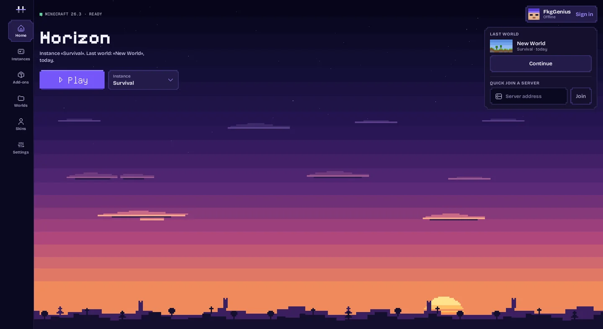
</p>

> **Неофициальный и самостоятельный проект.** Horizon Aurora — форк [Horizon](https://github.com/horizon-rust/horizon) на
> основе кода Horizon Android — Android-порта, который позже влился в [Starling](https://github.com/starling-client/starling).
> Это не официальная сборка Horizon, Horizon Android или Starling, и проект не связан с Mojang или Microsoft и не одобрен
> ими. О проблемах с Aurora пишите [сюда](https://github.com/IAmFuckingGenius/horizon-aurora/issues), а не в исходные проекты.

## Скачать

**[Последний релиз](https://github.com/IAmFuckingGenius/horizon-aurora/releases/latest)**: по APK на каждую архитектуру,
большинству телефонов нужен **arm64-v8a**. При первом запуске приложение скачивает оригинальные ресурсы Minecraft с серверов
Mojang. Aurora ставится отдельным приложением рядом с Horizon Android и Starling: миры переносятся экспортом и импортом.
Экспериментальные сборки каждого изменения лежат в пре-релизе [`dev`](https://github.com/IAmFuckingGenius/horizon-aurora/releases/tag/dev)
(«Aurora Dev», ставится рядом с релизом). Как выпускаются релизы: [docs/android-releases.md](docs/android-releases.md).

## Что нового

<table>
  <tr>
    <td width="50%" valign="top">
      <h3>Новый лаунчер</h3>
      Главная, Инстансы, Дополнения, Миры, Скины и Настройки в едином пиксельном стиле, в альбомной и портретной
      ориентации. Все описания написаны полностью. Английский и русский, язык переключается в настройках.
    </td>
    <td width="50%" valign="top">
      <h3>Инстансы</h3>
      У каждого инстанса своё имя, свои миры, настройки и дополнения и свой движок. Новый инстанс сразу получает ваш
      язык, управление и настройки графики.
    </td>
  </tr>
  <tr>
    <td valign="top">
      <h3>Сменные движки</h3>
      Соберите игру на компьютере, например с нативными модами, упакуйте её в <code>.hengine</code> и запускайте без
      переустановки приложения. Маленькая загрузочная библиотека подгружает движок на один запуск; если движок не
      запустился, включается встроенный и объясняет почему.
    </td>
    <td valign="top">
      <h3>Horizon Boost</h3>
      Скорость, качество и нагрев на одной странице в стиле Minecraft, у каждой настройки написано, чего она стоит и что
      делает: плотность и брызги дождя, анимации текстур, детали неба, туман, загрузка чанков и ограничение при нагреве —
      выключено, мягкое, сбалансированное или сильное, с минимумом кадров.
    </td>
  </tr>
  <tr>
    <td valign="top">
      <h3>Редактор управления</h3>
      Перетаскивайте, масштабируйте щипком и выравнивайте любую кнопку. Свои кнопки с подписями, комбинациями клавиш,
      переключателем и свайпом, формами и цветами; где показывать каждую кнопку — в игре, в меню, всегда или никогда;
      именованные раскладки с отменой, повтором и кодами для обмена.
    </td>
    <td valign="top">
      <h3>Аккаунты и скины</h3>
      Офлайн, Microsoft и Ely.by с быстрым переключением и гардероб с 3D-превью для скинов и плащей — своих или из
      аккаунта.
    </td>
  </tr>
  <tr>
    <td valign="top">
      <h3>Файлы через Android</h3>
      Импорт и экспорт миров в ZIP, отправка отчётов и журналов — всё через системный выбор файлов, без разрешения на
      доступ к памяти.
    </td>
    <td valign="top">
      <h3>Движок под телефон</h3>
      Сохраняет одиночную игру, когда вы выходите из приложения, сбавляет нагрузку при нагреве, освобождает кэши при
      нехватке памяти и рисует дождь более лёгким шейдером.
    </td>
  </tr>
</table>

## Скриншоты

Waydroid (x86_64), альбомная ориентация. Страницы внутри игры используют родные виджеты Minecraft.

| Инстансы | Инстанс и его движок |
| --- | --- |
| 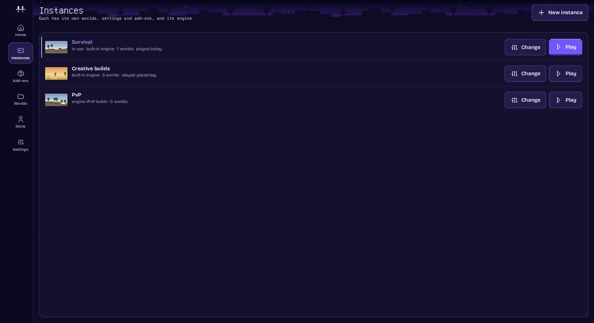 | 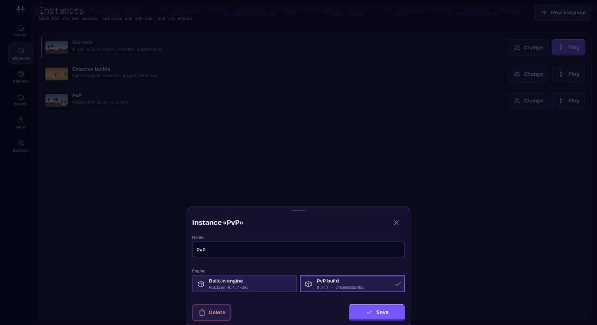 |

| Движки | Скины и плащи |
| --- | --- |
| 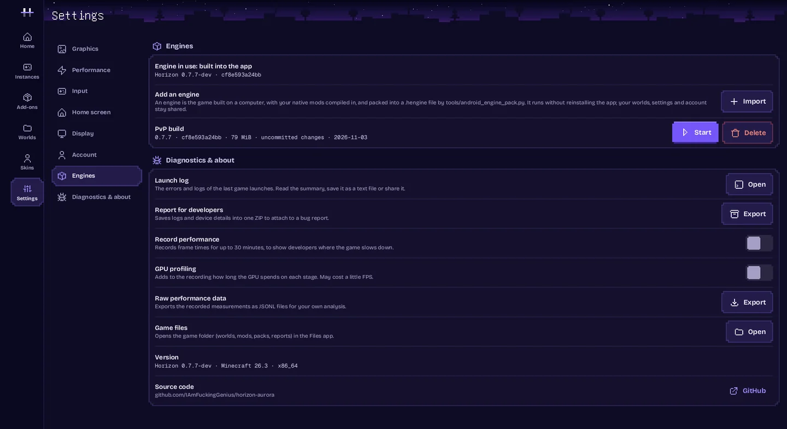 | 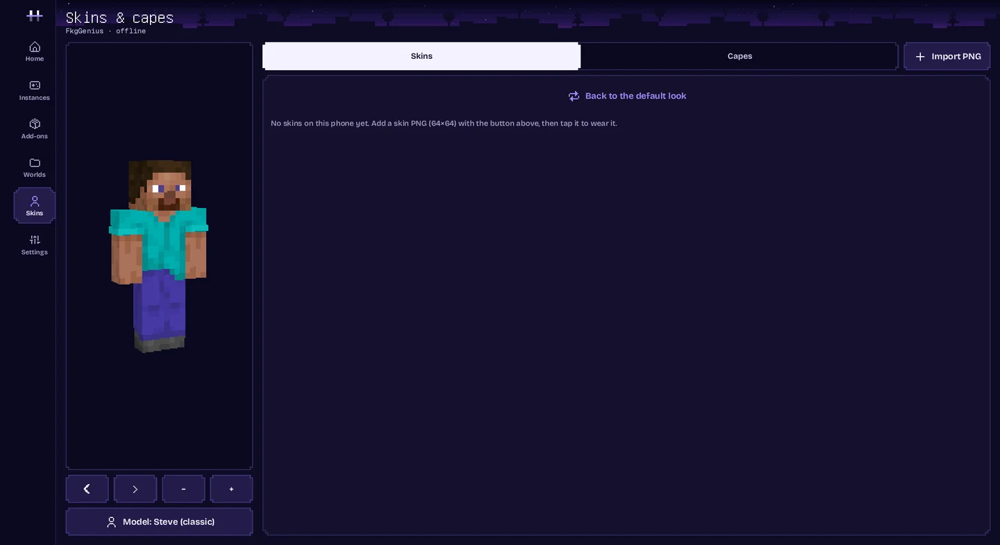 |

| Аккаунты | Миры |
| --- | --- |
| 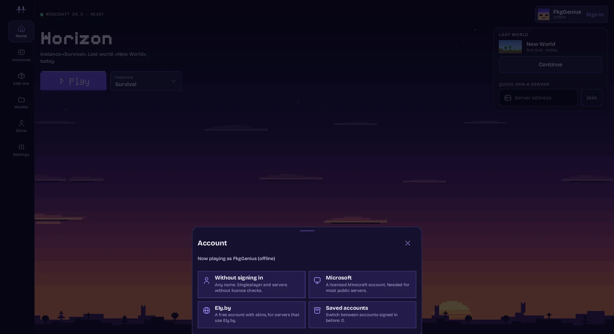 | 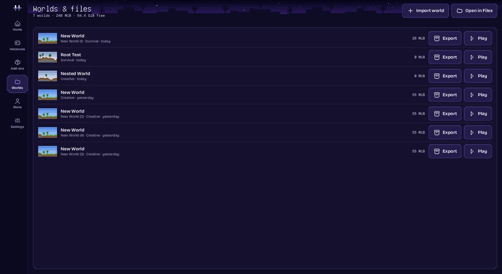 |

| Horizon Boost | Ограничение при нагреве |
| --- | --- |
| 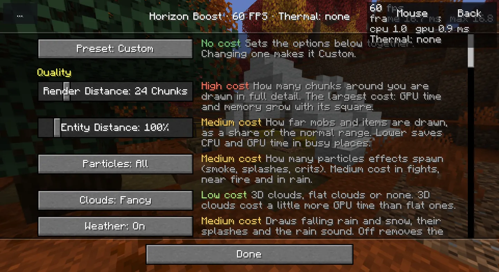 | 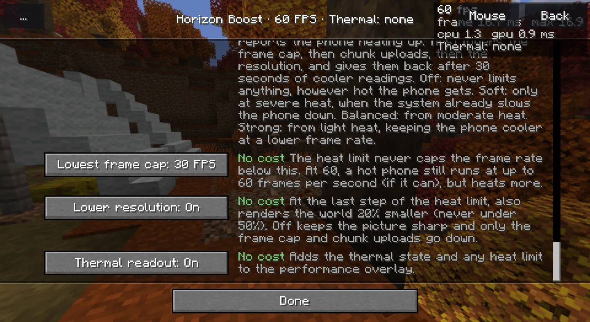 |

| В мире | Редактор управления |
| --- | --- |
| 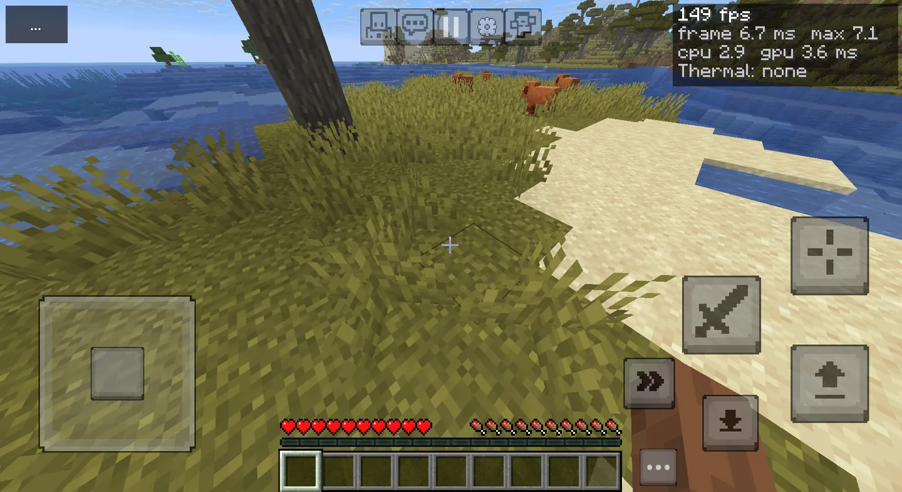 | 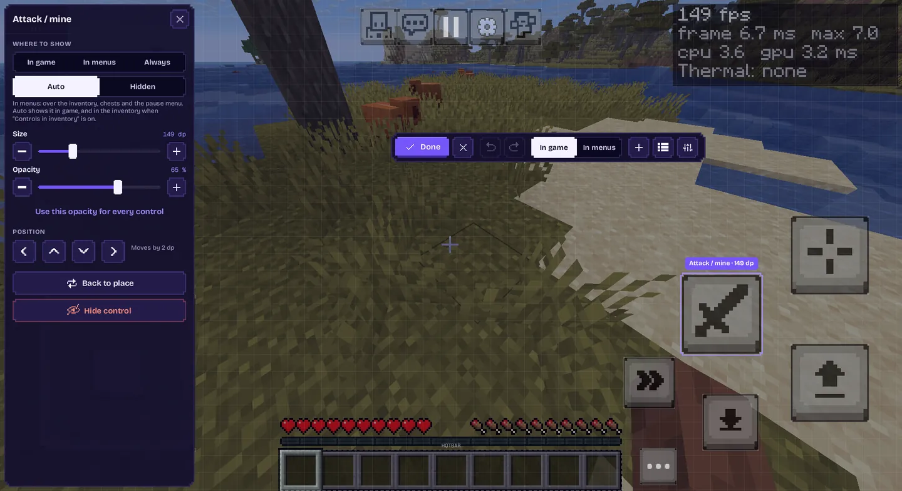 |

## Движки и инстансы

**Движок** — это сама игра: та же `libhorizon_android.so`, что лежит в APK, собранная из любого дерева, например с
нативными модами. **Инстанс** — то, во что вы играете: имя, движок и папка с игрой.

```sh
# На компьютере, из этого репозитория: собрать и упаковать движок для телефона
python3 tools/android_engine_pack.py --abi arm64-v8a --name "Моя сборка"
# → .local/android/engines/<id>-arm64-v8a.hengine
```

Скопируйте файл на телефон и в лаунчере откройте **Настройки › Движки › Импорт**. Лаунчер сначала спросит: движок работает
со всеми правами приложения, поэтому ставьте только те, что собрали сами или которым доверяете. Создайте на нём инстанс
в **Инстансы › Новый инстанс** и нажмите **Играть**: приложение перезапустится на этом движке и откроет инстанс. Миры,
аккаунты и скачанные файлы игры остаются общими.

Можно и без компьютера: **Настройки › Движки › Движки от Aurora** скачивает свежий dev-движок или движок более нового
релиза прямо из релизов этого репозитория, с проверкой по списку релиза.

Как это устроено, формат `.hengine` и проверки при импорте: [docs/android-engines.md](docs/android-engines.md).

## Сборка

Для сборки нужны Android SDK и NDK; настройка и подготовка ресурсов описаны в [docs/android.md](docs/android.md).

```sh
python3 tools/android_build.py --abi arm64-v8a            # отладочный APK для своего телефона
python3 tools/android_build.py --abi arm64-v8a --public   # APK для распространения
```

Распространять можно только публичные APK: в них только сгенерированные таблицы Horizon, а оригинальные ресурсы
Minecraft скачиваются с серверов Mojang на устройстве. Отладочные APK могут содержать закрытые наборы ресурсов. Подробнее:
[docs/android-publication.md](docs/android-publication.md). Тесты Android-частей форка:

```sh
python3 tools/test_android_engines.py   # движки, загрузочная библиотека и инстансы
python3 tools/test_android_worlds.py    # импорт и экспорт миров в ZIP
```

## Языки

Лаунчер и все настройки, добавленные в Aurora, написаны на английском и переведены на русский. Лаунчер следует языку
Android или выбору в **Настройки › Экран › Язык**; у игры свой язык в её настройках, ванильный текст переведён самим
Minecraft.

## Откуда взялась Aurora

- **[Horizon](https://github.com/horizon-rust/horizon)** — Minecraft: Java Edition 26.3, переписанный на Rust и сверяемый
  с настоящей игрой дифференциальными тестами. Aurora — его форк и вливает его изменения напрямую.
- **Horizon Android** перенёс Horizon на Android: нативная активити, рендер через Vulkan и GLES, сенсорное управление,
  лаунчер, установка ресурсов на устройстве. В ноябре 2026 года он влился в
  [Starling](https://github.com/starling-client/starling) — отдельный Android-порт, ставший основой объединённого
  проекта; Horizon Android 0.7.8 стал его последним релизом.
- **Horizon Aurora** оставила своей основой код Horizon Android и развивает его самостоятельно: свой лаунчер, инстансы,
  движки, Horizon Boost и релизы; обновления Horizon вливаются сюда, последние исправления Horizon Android перенесены.

## Авторы и лицензия

- [Horizon](https://github.com/horizon-rust/horizon) — Ludovic Marie и участники Horizon: движок на Rust.
- Horizon Android — Vasysik и участники проекта: Android-порт, на котором построена Aurora (теперь часть
  [Starling](https://github.com/starling-client/starling)).
- Horizon Aurora: новый лаунчер, инстансы, движки, Horizon Boost, редактор управления, релизы и описанная выше
  Android-интеграция.

[MIT](LICENSE) для собственного кода проекта; зависимости сохраняют свои лицензии ([список](THIRD_PARTY_NOTICES.md)).
Minecraft — товарный знак Mojang Synergies AB; его код и ресурсы принадлежат Mojang и Microsoft по
[EULA Minecraft](https://www.minecraft.net/en-us/eula). Файлы игры, подготовленные ресурсы, аккаунты, APK и ключи
подписи в Git не хранятся.
